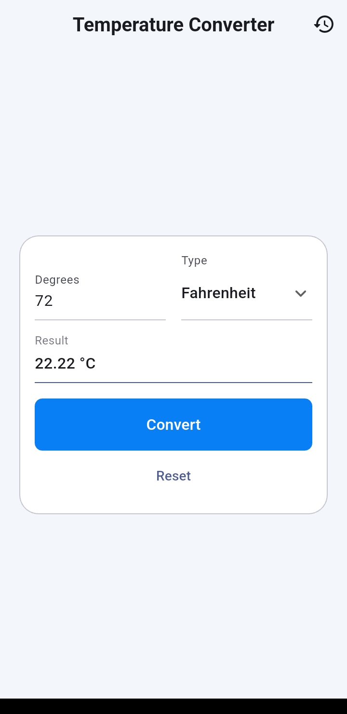
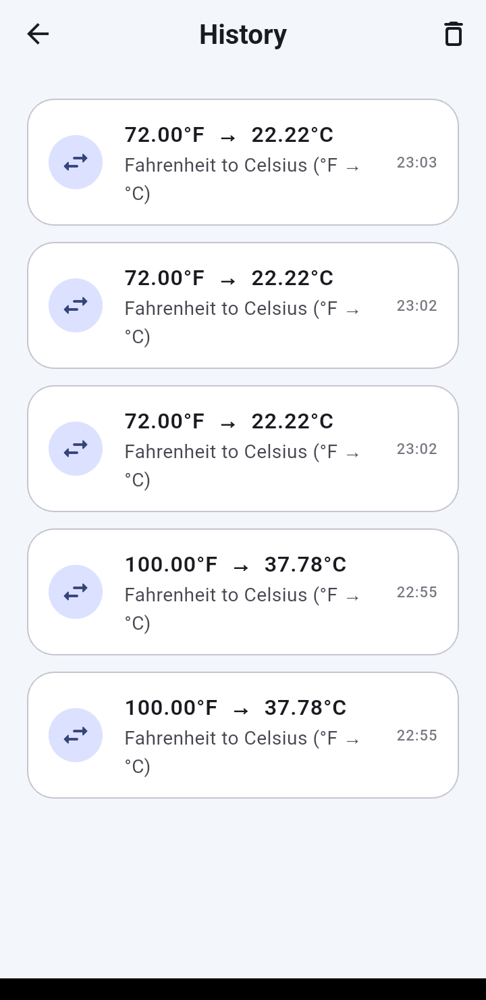

# Temperature Converter

A clean Flutter app that converts temperatures between Celsius and Fahrenheit.

## Features

- Side-by-side temperature input and conversion type selector
- Convert button with results shown to 2 decimal places
- Validation for empty and non-numeric input
- Conversion history (in memory only, no database)
- Splash screen and Material 3 UI

## Screenshots

  
  &nbsp;&nbsp;
  

  <em>Converter</em>
  &nbsp;&nbsp;&nbsp;&nbsp;&nbsp;&nbsp;&nbsp;&nbsp;&nbsp;&nbsp;
  <em>Conversion history</em>

## Formulas

- Celsius to Fahrenheit: F = (C × 9/5) + 32
- Fahrenheit to Celsius: C = (F − 32) × 5/9

## Tech

- Flutter, Dart
- State management: Provider

## Project structure

    lib/
      core/        app theme
      models/      ConversionType, ConversionRecord
      services/    TemperatureConverter (pure logic)
      providers/   ConverterProvider
      screens/     splash, converter, history
    test/          unit and widget tests

## Run

    flutter pub get
    flutter run

## Test

    flutter test